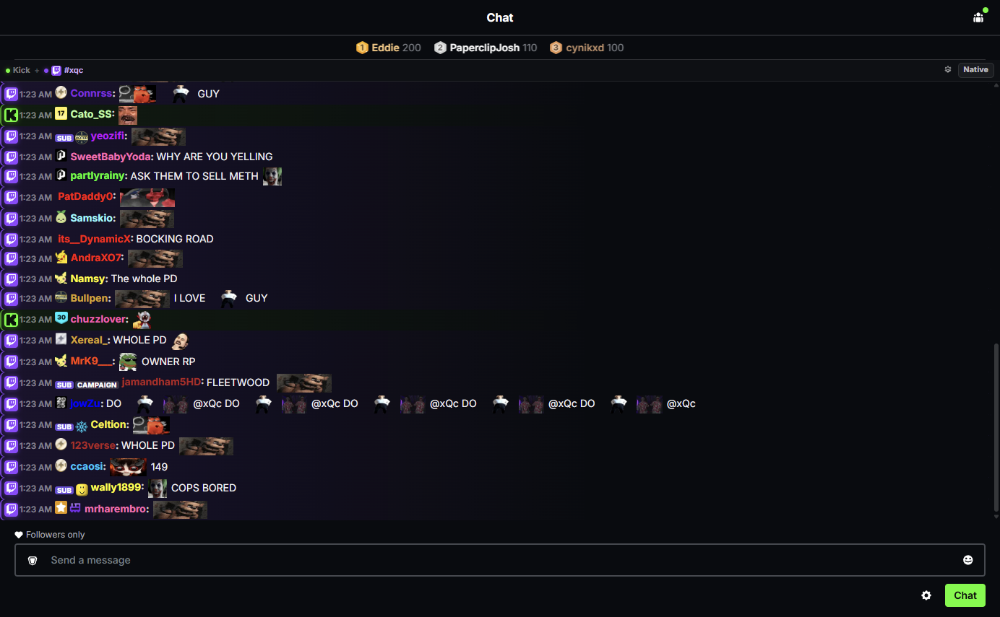
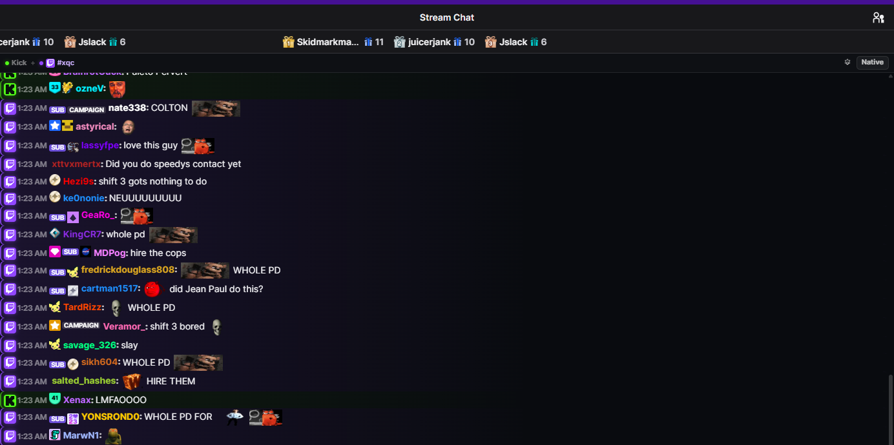
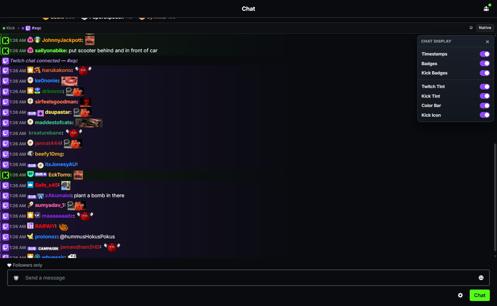
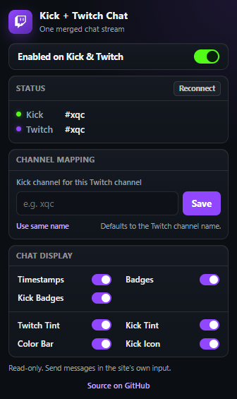

# Kick + Twitch Chat

[github.com/abilliontokens/kick-twitch-chat](https://github.com/abilliontokens/kick-twitch-chat)

A Chrome extension that merges **Kick and Twitch chat in either direction**. Open a Kick
channel and Twitch chat appears inside it; open a Twitch channel and Kick chat appears inside
it. Source icons, platform colors, badges, emotes (including 7TV), tints and source bars make
each message's origin obvious.

Kick mode:



Twitch mode:



## Download

- Releases: <https://github.com/abilliontokens/kick-twitch-chat/releases/latest>
- `kick-twitch-chat-1.2.0.zip` — clean package for the Chrome Web Store, or extract it and load unpacked.
- `kick-twitch-chat.crx` — self-signed CRX3 package (ID `fofamlemiddpagjngookpcokbdnokbcp`). Chrome stable blocks off-store CRX installs; use the ZIP/unpacked build unless your browser or enterprise policy allows CRX sideloading.

## Install

Chrome 137+ removed the `--load-extension` command-line switch, so load it from the UI:

1. Open `chrome://extensions`.
2. Enable **Developer mode** (top right).
3. **Load unpacked** → select this folder (`D:\kick_twitch`).
4. Open any channel:
   - Kick: `https://kick.com/<channel>` or `https://kick.com/popout/<channel>/chat`
   - Twitch: `https://www.twitch.tv/<channel>` or `https://www.twitch.tv/popout/<channel>/chat`

The merged pane mounts inside the site's chat column. Click the gear in the pane bar for quick
display settings, or the toolbar icon for the full popup.

## Usage

- **Channel mapping**: defaults to the same name on both platforms. If the streamer uses a
  different name, set it once in the popup — `Twitch channel for this Kick channel` on Kick,
  or `Kick channel for this Twitch channel` on Twitch. Mappings are stored in
  `chrome.storage.sync` and applied live.
- **Native** button (pane bar): shows the site's original chat list. Click **Merged** to switch
  back.
- **Gear** (pane bar): quick display settings.
- **Popup**: enable/disable on both sites, mapping, and all display settings.

Settings:

| Setting | Effect |
| --- | --- |
| Enabled on Kick & Twitch | Mounts/removes the merged pane. |
| Timestamps | Shows HH:MM before each message. |
| Badges | Master switch for all badges. |
| Kick Badges | Hides only Kick level/identity icons, keeps Twitch badges. |
| Twitch Tint | Purple background for Twitch messages. |
| Kick Tint | Green background for Kick messages. |
| Color Bar | Colored source bar at the far left of every message (purple for Twitch, green for Kick), independent of the tints. |
| Kick Icon | Kick logo in the gutter of each Kick message. |

The mini settings menu (pane gear):



The extension popup:



## How it works

- **Kick chat on Kick** uses Kick's Centrifugo gateway plus a Pusher sidecar on the same public
  `chatrooms.<chatId>.v2` channel. Guest clients get a connection token from
  `web.kick.com/api/v1/realtime/connection`, a channel token from `/auth/channel` (empty for
  guests), and subscribe over `wss://realtime.*.platform.kick.com`. The sidecar keeps chat live
  if either transport reconnects. History is seeded from
  `web.kick.com/api/v1/chat/<chatId>/history` when available. No account or cookies are required.
- **Twitch chat** uses anonymous read-only IRC over WebSocket
  (`wss://irc-ws.chat.twitch.tv:443`, `NICK justinfan…`) with the `tags` capability, which
  provides display names, colors, badges, emotes, replies and bits. No OAuth token.
- **Kick chat on Twitch**: Kick's realtime WebSocket rejects non-`kick.com` origins, and
  Kick's official Chat API only exposes authenticated sending/deleting (no read stream). The
  extension instead subscribes to Kick's public Pusher chat channel, resolving the current
  app key/cluster from the realtime bootstrap (`accepted_providers: [pusher]`) through the
  service worker. Messages are deduped by id. History polling remains only as a slow fallback
  and gap reconciler: 5 s with exponential backoff when Pusher is unavailable, 30 s when it is
  live. The history endpoint can be empty or rate-limited; Pusher carries the live feed.
- **7TV emotes** are resolved from the 7TV v3 API (global set + the Kick/Twitch channel set)
  because the 7TV browser extension cannot inject into our pane. Zero-width emotes are
  overlaid. Trimmed emote indexes are cached in `storage.local` for an hour.
- **Twitch badge images** come from Twitch's public GQL `badges` query (global sets) through
  the service worker and are cached for a day. Channel-specific subscriber/founder badges have
  per-channel artwork that needs OAuth, so they render as compact text pills (`SUB`, `GIFTER`,
  …).
- The pane is an overlay inside the chat list's host element: both sites use virtualized or
  React-managed message lists that cannot be interleaved safely. The native list keeps running
  underneath; **Native** reveals it.

## Limitations

- Read-only. Messages are sent with the site's own input.
- The merged view replaces the native list, so site-specific hover actions (reply, mention, mod
  tools) are only available via **Native**.
- Twitch mode depends on Kick's public Pusher channel. If Pusher is unavailable, the fallback
  history endpoint is slower and can be empty/rate-limited, so live Kick messages may pause
  until Pusher reconnects. History seeding may also be empty for the same reason.
- Pusher is a legacy public transport; the extension refetches its key/cluster from Kick on
  errors, and falls back to history polling.
- Anonymous Twitch IRC is a public read path Twitch may rate-limit or change.
- Kick's realtime/chat endpoints are internal and may change. The pane reports connection
  failures on its status dots instead of failing silently.
- 7TV personal emotes (account-only, no channel set) are not included.
- The pane uses the dark Kick styling on both sites.

## Permissions

- `storage` — settings and badge/emote caches.
- `https://gql.twitch.tv/*` — Twitch global badge metadata.
- `https://7tv.io/*` — 7TV emote sets (fetched by the service worker, trimmed and cached).
- `https://kick.com/*`, `https://web.kick.com/*` — Kick channel metadata, Pusher credentials
  and guest chat history (service worker).
- Content scripts on `kick.com` and `www.twitch.tv` — mount the pane and read chat.

## Development

The extension is plain MV3, no build step. `src/` holds the content scripts and service worker;
`src/main.js` drives Kick, `src/twitch-main.js` drives Twitch; `popup/` is the toolbar UI.

`tools/` contains the local verification harness used against a real Chrome:

```bash
bun tools/load_ext.js       # launch Chrome with --enable-unsafe-extension-debugging and load unpacked
bun tools/reload_ext.js     # uninstall + reload after code edits
bun tools/verify_final.js   # Kick mode smoke test + screenshot
bun tools/verify_twitch.js  # Twitch mode smoke test + screenshot
bun tools/verify_twitch_nav.js
bun tools/verify_popup_fit.js
```

It talks CDP on port 9333 and writes screenshots/evidence into `research/`.
